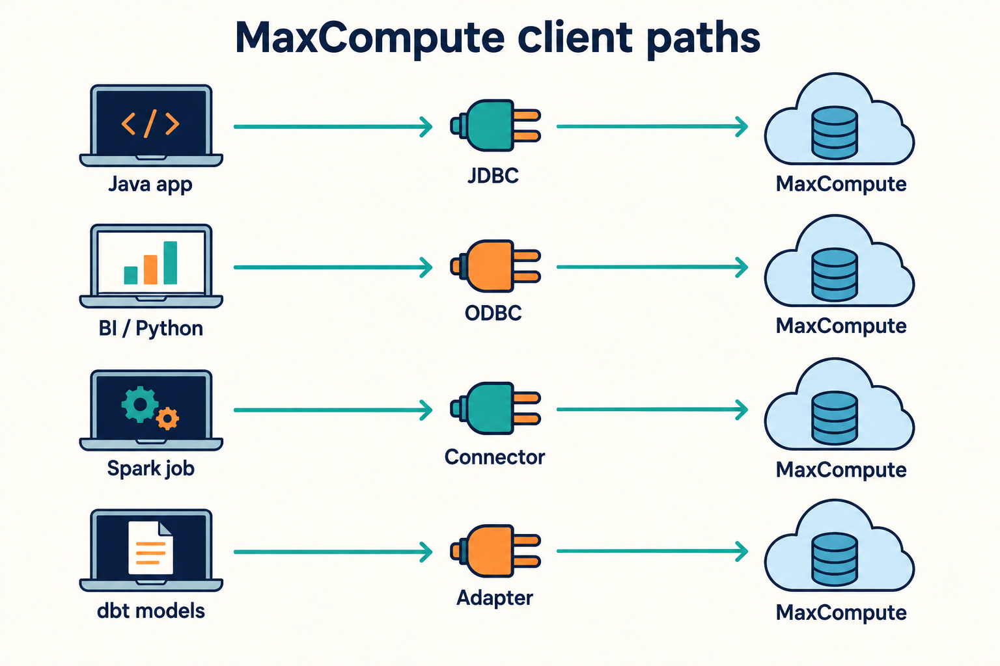

## 按你的工作选择

图中的箭头表示连接关系，各工具的执行位置与结果读取方式不同。下面的表给出具体选择：

| 你的任务                                 | 使用入口                                                       | 第一项验证                  |
| ---------------------------------------- | -------------------------------------------------------------- | --------------------------- |
| 在 Java 程序中管理项目、表、资源、函数等 | [SDK 官方文档](https://aliyun.github.io/aliyun-odps-java-sdk/) | 按 SDK 快速开始连接         |
| 接入已有 Java SQL 程序或 JDBC 工具       | [JDBC](../products/jdbc/index.mdx)                             | 常量 SELECT 与 ResultSet    |
| 使用 Python pyodbc 或支持 ODBC 的工具    | [ODBC](../products/odbc/index.mdx)                             | 驱动注册，然后常量 SELECT   |
| 在外部 Spark 中访问 MaxCompute 表        | [Spark Connector](../products/spark/index.mdx)                 | Catalog 发现与小表读取      |
| 用 SQL 模型构建数据转换、依赖与数据测试  | [dbt](../products/dbt/index.mdx)                               | parse、连接、测试模型 build |
| 在命令行或 Agent 中执行结构化操作        | [CLI](../products/cli/quickstart.mdx)                          | 登录与首条查询              |

## 每条路径都要确认的输入

准备项目、地域和网络对应的 Endpoint、授权身份、工具版本与目标对象。连接成功、查询成功、结果读取成功各自验证。涉及数据写入时，先确定测试表、影响范围与清理条件；配置或身份缺失时继续本地检查，不猜测云端输入。

SDK 的完整指南保留在已有官方站点。驱动与连接器的快速开始、参数、排障和 Agent 检查单可以从上表进入。
