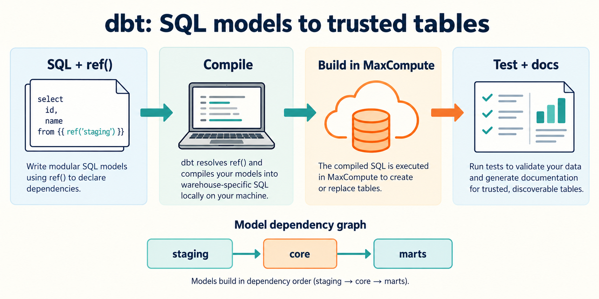

dbt 把 SQL 转换逻辑组织为一个工程。你写模型，使用 `ref()` 声明依赖，dbt 编译并通过 `dbt-maxcompute` Adapter 把 SQL 提交给 MaxCompute，再运行数据测试和生成文档。

本地执行 dbt 命令，SQL 计算发生在 MaxCompute。dbt 是 ELT 的转换层；原始数据采集和加载需要另外的工具。

## 开始使用

| 目标                           | 入口                                |
| ------------------------------ | ----------------------------------- |
| 创建首个模型、测试并生成文档   | [快速开始](./quickstart.mdx)        |
| 依赖、增量、分区和 Delta Table | [模型指南](./guides.mdx)            |
| Profile 和模型配置             | [配置参考](./reference.mdx)         |
| Agent 自动检查与受控构建       | [Agent 执行指南](./agent-guide.mdx) |
| Profile、权限、模型和依赖问题  | [故障排查](./troubleshooting.mdx)   |
| 稳定版与预发布版本             | [版本说明](./release-notes.mdx)     |

入门示例采用 PyPI 稳定版 **1.11.3**、Python **3.11**，SQL 模型作为主线。MaxFrame Python 的 `table` / `incremental` 模型及 Python 标量、聚合 UDF 已在限定支持范围内正式 GA；MaxFrame 仍需安装可选依赖。`truncate_insert` 是需显式启用的整表替换策略，不改变现有策略默认行为。支持范围和限制见[模型指南](./guides.mdx)，旧版 UDF 的 CP27/CP37 升级配置见[配置参考](./reference.mdx#python-运行时兼容)。

事实来源：[dbt-maxcompute 仓库](https://github.com/aliyun/dbt-maxcompute)、[PyPI](https://pypi.org/project/dbt-maxcompute/)、[dbt 官方文档](https://docs.getdbt.com/docs/introduction)。
