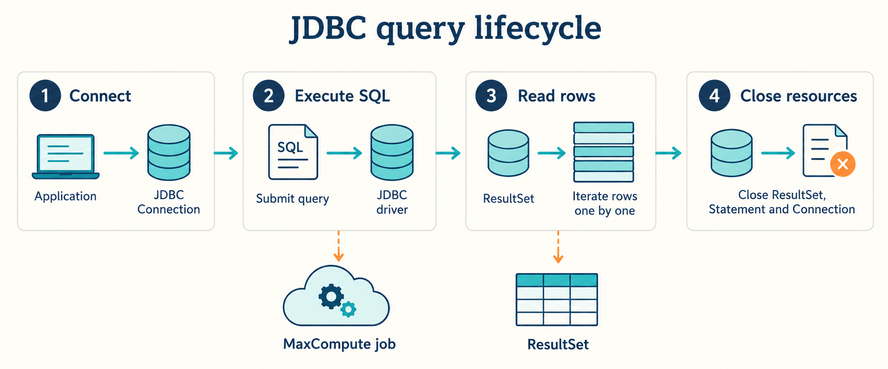

JDBC 是 Java 的标准数据库接口。MaxCompute JDBC Driver 把 `Connection`、`Statement`、`ResultSet` 接到 MaxCompute，适合已有 JDBC 程序和支持自定义 JDBC 驱动的 SQL 工具。

建立连接后，SQL 仍要经历服务端执行和结果下载；连接成功不代表查询或下载权限已经验证。

## 按你的目标开始

| 目标                          | 入口                                |
| ----------------------------- | ----------------------------------- |
| 跑通第一条 Java 查询          | [快速开始](./quickstart.mdx)        |
| 给现有程序或 SQL 工具接入驱动 | [使用指南](./guides.mdx)            |
| 查连接参数、STS 和结果限制    | [配置参考](./reference.mdx)         |
| 让 Agent 做有界验证           | [Agent 执行指南](./agent-guide.mdx) |
| 连接失败、结果缺失、依赖冲突  | [故障排查](./troubleshooting.mdx)   |
| 查驱动升级记录                | [版本说明](./release-notes.mdx)     |

## 选择 JDBC 还是 SDK

只需要标准 SQL 接口时使用 JDBC；需要操作项目、表、资源、函数或上传数据等 MaxCompute 专用 API 时，阅读 [MaxCompute SDK 文档](https://aliyun.github.io/aliyun-odps-java-sdk/)。

本指南入门示例使用公开驱动 **3.10.14**，默认普通 SQL 模式。交互查询、连接池和具体 BI 工具应在目标环境单独验证；MaxCompute 的批处理语义与传统关系数据库不同。

## 事实来源

连接及参数来自 [JDBC 官方仓库](https://github.com/aliyun/aliyun-odps-jdbc) 和 [阿里云 JDBC 文档](https://help.aliyun.com/document_detail/143408.html)。版本以 [Maven Central](https://central.sonatype.com/artifact/com.aliyun.odps/odps-jdbc) 为准。
