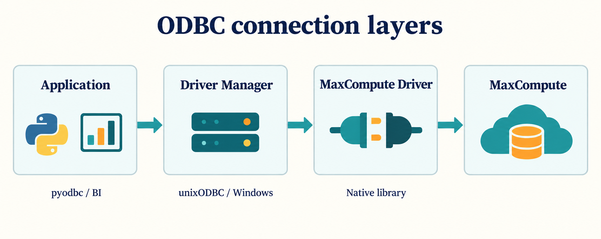

ODBC 是应用访问数据源的标准接口。Python 的 `pyodbc` 和部分 BI 工具通过 Driver Manager 加载 MaxCompute 原生驱动，再访问 MaxCompute 服务。

`pip install pyodbc` 只安装 Python 接口；还需要原生驱动、驱动注册以及匹配的进程架构。

## 阅读路径

- [快速开始](./quickstart.mdx)：安装、注册并执行一条只读 SQL。
- [使用指南](./guides.mdx)：连接字符串、BI 接入、资源与类型。
- [配置参考](./reference.mdx)：参数、环境变量和 STS。
- [Agent 执行指南](./agent-guide.mdx)：先检查本地加载，再验证服务。
- [故障排查](./troubleshooting.mdx)：区分 Driver Manager 和服务端问题。
- [版本说明](./release-notes.mdx)：下载和源码版本入口。

## 本指南范围

来源是 [MaxCompute ODBC 公共仓库](https://github.com/aliyun/alibabacloud-maxcompute-odbc-driver) 的 `main` 分支，Windows MSI 的注册行为对照安装定义。不同安装包可能落后于源码；把版本和平台记录下来，再使用相应参数。能够执行查询不代表某个 BI 工具的元数据、事务或参数绑定路径都已适配。
