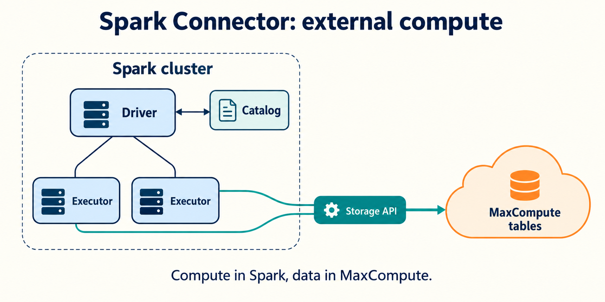

Spark Connector 把 MaxCompute 表接入外部 Apache Spark。Spark 的 Driver 和 Executor 运行在你的 Spark 环境中；Connector 访问表元数据与数据，Spark 负责执行自己的计算任务。

## 先选对路径

| 场景                                          | 入口                                                                            |
| --------------------------------------------- | ------------------------------------------------------------------------------- |
| 已有 Spark 集群，希望访问 MaxCompute 表       | 本空间的 [Connector 快速开始](./quickstart.mdx)                                 |
| 希望把 Spark 作业提交到 MaxCompute 集群内运行 | [MaxCompute Spark 集群模式](https://help.aliyun.com/en/maxcompute/cluster-mode) |
| 使用旧 `spark-datasource-v2.3` / `v3.1` 模块  | 对照原模块文档，迁移前核对 API 和版本                                           |

上述路径的安装包、参数与运行位置不同，不能混用。

## 阅读路径与基线

先看[快速开始](./quickstart.mdx)，再查[读写指南](./guides.mdx)、[配置参考](./reference.mdx)、[故障排查](./troubleshooting.mdx)和[Agent 执行指南](./agent-guide.mdx)。

官方外部 Connector 文档描述 Spark **3.2.x—3.5.x**；当前公开构建默认 **Spark 3.3.1 / Scala 2.12**。本空间以此作为示例基线，其他 Spark/Scala 组合需核对并重新构建验证，不能假定 Spark 4.x 二进制兼容。

## 事实来源

[官方 Spark Connector 指南](https://help.aliyun.com/en/maxcompute/spark-connector)；[公开 Connector 源码](https://github.com/aliyun/aliyun-maxcompute-data-collectors/tree/master/spark-connector)；[上游文档](https://aliyun.github.io/aliyun-maxcompute-data-collectors/docs/spark-connector/overview/)。
